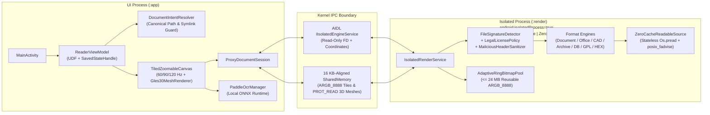
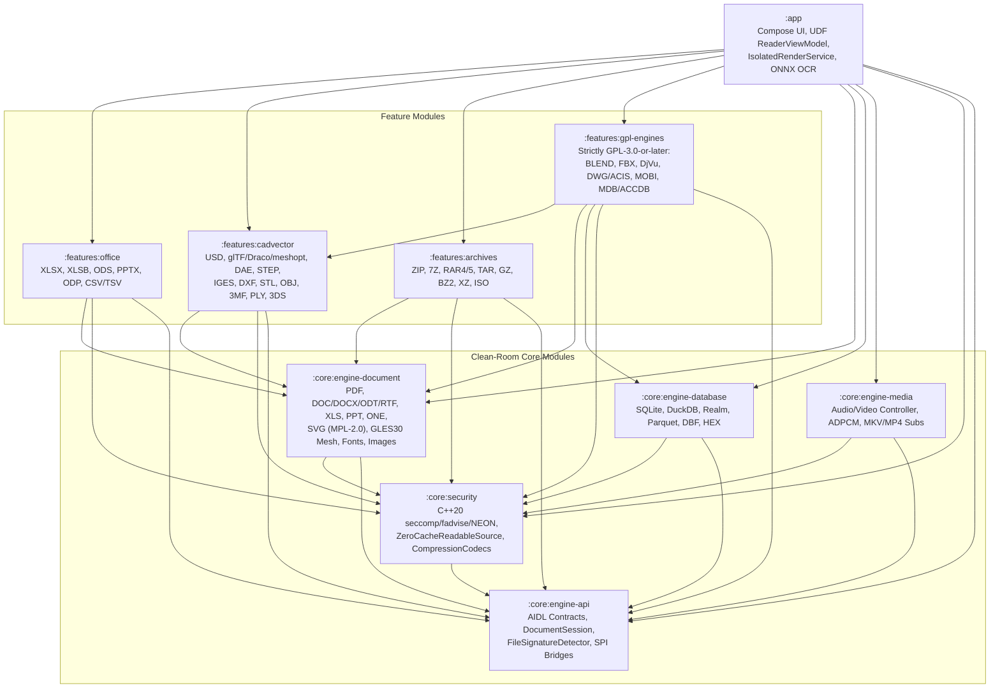
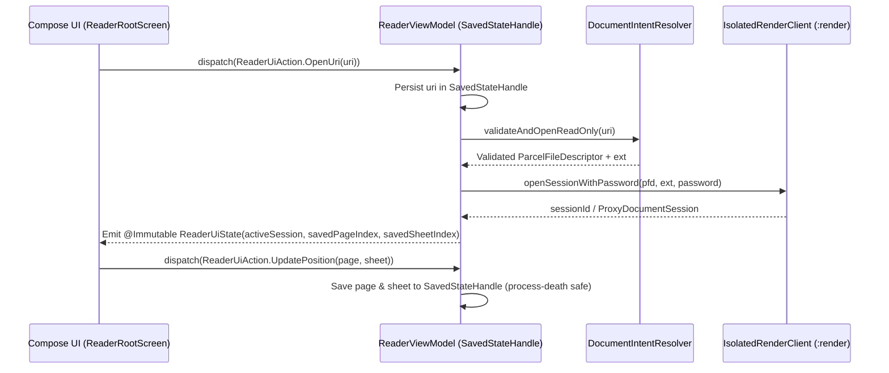

# FullFileStudio — System Architecture

**FullFileStudio** is an offline, multi-process universal file reader and inspector for Android 11+ (`minSdk = 30`, `targetSdk = 37`, Kotlin `2.4.21`, Java `25` build toolchain, C++20 NDK). Every untrusted binary container is parsed out-of-process inside an unprivileged Linux sandbox (`android:isolatedProcess="true"` + `seccomp-bpf`), while rendered tiles and 3D geometry cross the process boundary via 16 KB-aligned kernel `SharedMemory` (`ashmem`).

---

## 1. Multi-Process Security & Rendering Boundary

### Defense-in-Depth Layers

1. **URI & Sandbox Escape Prevention (`DocumentIntentResolver`):**
   Incoming `content://` and `file://` URIs are opened strictly read-only (`MODE_READ_ONLY`). Before passing any `ParcelFileDescriptor` to `:render`, `DocumentIntentResolver` resolves canonical filesystem paths and `/proc/self/fd/<n>` symlinks to ensure an attacker-crafted intent cannot trick the app into reading its own private sandbox (`dataDir` or `deviceProtectedDataDir`).
2. **Kernel UID + `seccomp-bpf` Isolation (`IsolatedRenderService` + `SecurityArena`):**
   The `:render` service runs under an ephemeral Android isolated UID with zero filesystem permissions and zero network sockets. On startup, `native_security_arena.cpp` enforces `PR_SET_NO_NEW_PRIVS` and installs a `seccomp-bpf` filter trapping `execve`, `execveat`, `socket`, `connect`, `bind`, `listen`, `accept4`, `sendto`, and `ptrace` with `EPERM`.
3. **Header Sanitization & DRM Compliance (`MaliciousHeaderSanitizer` + `LegalLicensePolicy`):**
   - `LegalLicensePolicy` blocks proprietary DRM-encrypted containers (`Kindle KFX/DRM`, `Office IRM/RMS`, `DRM EPUB`, `DRM PDF`, encrypted media) and enforces PDF `/P` copy-restriction flags.
   - `MaliciousHeaderSanitizer` intercepts `ELF`, `DEX`, Mach-O, and PE executables, PDF/ZIP polyglots, and XML `<!ENTITY` / `<!DOCTYPE` XXE payloads before format parsers execute, routing raw binaries safely to the read-only `UniversalHexInspectorImpl`.
4. **Crash Containment & Automatic Rebind (`AndroidIsolatedRenderClient`):**
   If a malformed multi-gigabyte file triggers a native abort or `OutOfMemoryError` inside `:render`, the UI process remains unaffected, surfaces a localized `StructuredUiError`, and automatically re-establishes the service binding.

---

## 2. 10-Module Directed Acyclic Graph (DAG)

All modules share centralized build conventions via the `build-logic` included build (`fullfilestudio.android.application`, `fullfilestudio.android.library`, `fullfilestudio.quality`), enforcing `allWarningsAsErrors = true` (`-Werror`), zero split-packages (`verifyZeroSplitPackages`), and package-to-directory parity (`verifyModuleArchitecture`).

### Dual-Licensing Boundary

Clean-room modules (`:core:*`, `:features:office`, `:features:cadvector`, `:features:archives`) have **zero compile-time dependencies** on `:features:gpl-engines`. Optional GPL-derived format support (`BLEND`, `FBX`, `DjVu`, `DWG/ACIS`, `MOBI/AZW3`, `MDB/ACCDB`) is wired inward via SPI interfaces in `me.hlebkukleuski.fullfilestudio.core.engine.bridge` (`GplCoreEngineBridge`, `GplCadEngineBridge`). Removing `:features:gpl-engines` from `app/build.gradle.kts` yields a 100% clean-room build (with file-level `MPL-2.0` isolation in `core/document/svg/*.kt`).

---

## 3. Unidirectional Data Flow (UDF) & Dependency Injection

- **Constructor-Injected `AppContainer`:** `FullFileStudioApp` initializes a single `DefaultAppContainer` providing `AppSettingsManager`, `IsolatedRenderClient`, `DocumentIntentResolver`, `FirstLaunchEngineBootstrapper`, and flavor-specific `StandaloneUpdateManager`.
- **Zero Framework Coupling in `ReaderViewModel`:** `ReaderViewModel` extends `androidx.lifecycle.ViewModel` (not `AndroidViewModel`), enabling fast deterministic unit tests (`ReaderViewModelAndIntentTest`) covering URI routing, archive virtual-FD back-stack traversal, password retry flows, and OS process-death state restoration.

---

## 4. Compile-Time Flavor Isolation (`googlePlay` vs `standalone`)

| Capability | `googlePlay` Flavor | `standalone` Flavor |
| :--- | :--- | :--- |
| `INTERNET` / `ACCESS_NETWORK_STATE` | Stripped via `tools:node="remove"` | `INTERNET` enabled for GitHub Releases check |
| `REQUEST_INSTALL_PACKAGES` | Stripped & absent from DEX | Declared for user-approved APK upgrade |
| `StandaloneUpdateManager` | Offline no-op (`isSupported = false`) | TLS 1.3 + SHA-256 + signing-certificate pinning |
| `FileProvider` (`file_paths.xml`) | Absent | Scoped strictly to `updates/` cache subdir |
| CI Binary Gate | Verified by `scripts/verify_play_isolation_and_alignment.py` | Built & signed alongside Play artifacts |

---

## 5. Architecture Decision Records

- [ADR-001: Unprivileged Isolated Process & `seccomp-bpf` Sandbox](adr/ADR-001-isolated-process-seccomp-sandbox.md)
- [ADR-002: Zero-Copy Positional I/O (`Os.pread`) & 16 KB `SharedMemory` Tile IPC](adr/ADR-002-zero-copy-pread-and-ashmem-ipc.md)
- [ADR-003: Source-Set Isolation Between `googlePlay` and `standalone` Product Flavors](adr/ADR-003-play-store-vs-standalone-flavor-isolation.md)
- [ADR-004: Physical Module Isolation of GPL-Derived Engines & Dual-Licensing Architecture](adr/ADR-004-gpl-module-boundary-and-dual-licensing.md)
- [ADR-005: 10-Module Directed Acyclic Graph & `build-logic` Gradle Convention Plugins](adr/ADR-005-multi-module-dag-and-convention-plugins.md)
- [ADR-006: Unidirectional Data Flow (`ReaderViewModel` + `SavedStateHandle`) & 120 Hz Tile Canvas](adr/ADR-006-unidirectional-data-flow-and-120fps-canvas.md)
